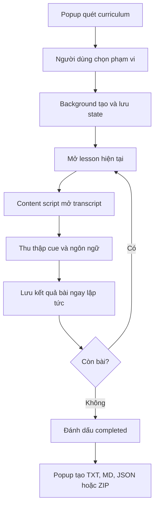

# Udemy Transcript Copier

Chrome Extension dùng để sao chép transcript của bài học hiện tại hoặc tự động thu thập transcript của toàn bộ khóa học trên Udemy và Udemy Business.

Tác giả: **tuantq** · GitHub: **[@tqt97](https://github.com/tqt97)**

## Tính năng

- Xuất toàn khóa học, nhiều section hoặc một khoảng bài tùy chọn.
- Tự mở từng bài và tự mở bảng transcript.
- Chọn ngôn ngữ transcript khi video có nhiều phụ đề.
- Theo dõi tiến độ, bài hiện tại và thời gian còn lại dự kiến.
- Tạm dừng, tiếp tục và tự lưu kết quả sau mỗi bài.
- Watchdog phát hiện tiến trình bị đứng và tự khởi động lại bài hiện tại.
- Thử lại tối đa ba lần khi đọc transcript gặp lỗi tạm thời.
- Hiển thị danh sách bài bị bỏ qua và hỗ trợ **Retry failed lessons**.
- Kiểm tra đúng khóa học trước khi tiếp tục trên tab mới.
- Tìm kiếm trong toàn bộ transcript đã thu thập.
- Xuất Markdown, TXT hoặc JSON.
- Xuất mỗi bài thành một file, mỗi section thành một file hoặc gộp toàn bộ.
- Tùy chọn timestamp, chuẩn hóa văn bản, loại filler và mục lục Markdown.
- Menu chuột phải và phím tắt điều chỉnh tốc độ video.
- Giao diện tiếng Việt mặc định, có thể chuyển sang tiếng Anh.
- Trang chẩn đoán selector khi Udemy thay đổi giao diện.
- Không gửi transcript đến máy chủ bên ngoài.

## Quy tắc đặt tên file

Ở chế độ **mỗi bài một file**, tên file được lấy trực tiếp từ tiêu đề bài học trong curriculum và chuyển sang dạng slug:

```text
10. Horizontal Scaling Fundamentals
→ 10-horizontal-scaling-fundamentals.md
```

Extension không thêm `001-`, `002-` hoặc một số thứ tự khác ở phía trước vì tiêu đề Udemy thường đã chứa số bài. Nếu hai bài trong cùng section tạo ra cùng một slug, file sau sẽ được thêm hậu tố `-2`, `-3` để tránh ghi đè.

Ví dụ cấu trúc ZIP:

```text
course-name-transcripts.zip
├── section-1-introduction/
│   ├── 1-welcome.md
│   └── 2-system-overview.md
└── section-2-building-blocks-of-scalability/
    ├── 10-horizontal-scaling-fundamentals.md
    └── 11-load-balancing.md
```

Tên file và thư mục được chuẩn hóa thành chữ thường, bỏ dấu tiếng Việt, thay nhóm ký tự đặc biệt hoặc khoảng trắng bằng dấu gạch ngang.

## Cài đặt

1. Giải nén `udemy-transcript-copier.zip`.
2. Mở `chrome://extensions`.
3. Bật **Developer mode**.
4. Chọn **Load unpacked** và mở thư mục `udemy-transcript-copier` đã giải nén.
5. Khi cập nhật từ bản cũ, bấm **Reload** rồi refresh tab Udemy để nạp lại content script.

Extension hỗ trợ cả Udemy thông thường (`www.udemy.com`) và domain Udemy Business của tổ chức (`company.udemy.com`).

## Cách sử dụng

1. Mở một video trong khóa học và giữ sidebar nội dung khóa học hiển thị.
2. Mở popup extension và bấm **Làm mới** nếu danh sách chưa xuất hiện.
3. Chọn toàn khóa, nhiều section hoặc khoảng bài.
4. Chọn ngôn ngữ transcript, định dạng và cách tổ chức file.
5. Mở **Tùy chọn nâng cao** nếu cần timestamp, chuẩn hóa văn bản hoặc mục lục.
6. Bấm **Bắt đầu xuất** và giữ tab Udemy mở.
7. Có thể đóng popup; background service worker vẫn điều phối tiến trình.
8. Khi hoàn tất, tải kết quả hoặc thử lại riêng các bài bị lỗi.

Nếu đóng tab Udemy, tiến trình sẽ chuyển sang trạng thái tạm dừng. Mở lại đúng khóa học trên một tab mới rồi bấm **Tiếp tục**.

## Cấu trúc dự án

```text
udemy-transcript-copier/
├── manifest.json          # Manifest V3, quyền, content script và shortcuts
├── background.js          # Điều phối export, retry, resume và watchdog
├── content.js             # Đọc DOM, điều hướng bài và trích xuất transcript
├── export-utils.js        # Chuẩn hóa, render TXT/MD/JSON và tạo ZIP
├── popup.html             # Cấu trúc giao diện popup
├── popup.css              # Design tokens, layout và trạng thái giao diện
├── popup.js               # State UI, i18n, tìm kiếm và lệnh export
├── diagnostics.html       # Trang chẩn đoán selector
├── diagnostics.css        # Giao diện trang chẩn đoán
├── diagnostics.js         # Tạo và hiển thị báo cáo chẩn đoán
├── icons/                 # Icon 16, 32, 48 và 128 px
└── README.md
```

Không sử dụng framework hoặc dependency runtime. Tất cả mã chạy bằng Web APIs và Chrome Extension APIs để gói cài đặt nhỏ, dễ kiểm tra và dễ tùy biến.

## Kiến trúc kỹ thuật

### `content.js` — adapter cho giao diện Udemy

Content script chạy trong trang Udemy và chịu trách nhiệm:

- Phát hiện khóa học từ hostname và slug URL.
- Quét curriculum, section và lesson từ các thuộc tính `data-purpose`.
- Hỗ trợ sidebar virtualized bằng cách cuộn, mở section mới xuất hiện và thu thập dần các row.
- Tìm lại bài bằng locator; nếu locator thay đổi, dùng tiêu đề bài làm fallback.
- Tự bấm mở transcript và thu thập toàn bộ cue kể cả danh sách transcript được render ảo.
- Đọc cue từ `TextTrack` khi có, sau đó fallback sang DOM transcript.
- Gửi kết quả về background bằng `chrome.runtime.sendMessage`.

Các message chính:

| Message | Chức năng |
| --- | --- |
| `GET_COURSE_OUTLINE` | Quét section và lesson |
| `GET_COURSE_IDENTITY` | Xác minh khóa học hiện tại |
| `GET_TRANSCRIPT_LANGUAGES` | Đọc danh sách phụ đề |
| `OPEN_COURSE_LESSON` | Tìm và mở một bài trong sidebar |
| `CAPTURE_COURSE_LESSON` | Mở transcript và trích xuất cue |
| `GET_UDEMY_TRANSCRIPT` | Đọc transcript của bài hiện tại |
| `GET_DIAGNOSTICS` | Xuất dữ liệu selector phục vụ debug |

### `background.js` — bộ điều phối tiến trình

Service worker giữ state export trong `chrome.storage.local` dưới key `courseExport`. State chứa:

- Khóa học và tab đang chạy.
- Danh sách bài đã chọn và kết quả theo index.
- Vị trí hiện tại và hàng đợi retry.
- Ngôn ngữ, định dạng và các tùy chọn xuất.
- Thống kê thời gian để tính ETA.
- Token capture để bỏ qua callback cũ hoặc trùng.
- Thời điểm cập nhật gần nhất cho watchdog.

Mỗi bài hoàn tất sẽ được lưu ngay. Vì vậy đóng popup không làm mất dữ liệu. Watchdog chạy bằng `chrome.alarms`; nếu state đang `running` nhưng không cập nhật quá ngưỡng, nó xóa trạng thái capture tạm và mở lại bài hiện tại.

### `popup.js` — presentation và command layer

Popup không trực tiếp điều khiển DOM Udemy. Nó:

- Đọc outline và ngôn ngữ từ content script.
- Tạo selection theo toàn khóa, nhiều section hoặc khoảng bài.
- Gửi lệnh start, pause, resume, retry và reset đến background.
- Render tiến độ từ `chrome.storage.onChanged`.
- Tìm kiếm cục bộ trong kết quả đã lưu.
- Gọi `ExportUtils.buildExport()` khi người dùng tải file.
- Quản lý giao diện Việt/Anh bằng dictionary nội bộ.

### `export-utils.js` — pipeline tạo file

Module này không phụ thuộc Chrome APIs nên có thể kiểm thử độc lập. Pipeline gồm:

1. Chọn kết quả đã capture hoặc tạo placeholder cho bài chưa xử lý.
2. Chuẩn hóa cue và tùy chọn timestamp.
3. Gộp câu, sửa xuống dòng và loại filler nếu được bật.
4. Render tài liệu theo Markdown, TXT hoặc JSON.
5. Tạo slug an toàn cho tên file.
6. Nhóm theo lesson, section hoặc một file tổng hợp.
7. Tạo ZIP bằng Store method và CRC32 viết bằng JavaScript thuần.

## Flow export



README hiển thị Mermaid trên GitHub. Sơ đồ không được extension sử dụng khi chạy.

## Cơ chế xử lý sidebar ảo

Udemy Business có thể chỉ render những lesson đang nằm trong vùng nhìn thấy. Khi chuyển bài, các section khác cũng có thể bị thu gọn. Luồng tìm bài xử lý bằng cách:

1. Tìm trực tiếp bằng locator `curriculum-item-sectionIndex-itemIndex`.
2. Mở những section đang collapsed trong khu vực curriculum.
3. Xếp hạng các container có khả năng cuộn bằng `overflowY` và kích thước nội dung.
4. Cuộn từng bước và tiếp tục mở các section mới được render.
5. Đối chiếu chính xác tiêu đề bài nếu locator không còn phù hợp.
6. Chỉ trả về lỗi sau khi hoàn thành các lượt quét.

## Lưu trữ và khả năng phục hồi

| Trạng thái | Ý nghĩa |
| --- | --- |
| `running` | Đang mở hoặc capture một bài |
| `paused` | Người dùng tạm dừng hoặc tab bị đóng |
| `completed` | Đã đi hết danh sách hiện tại |

`Retry failed lessons` tạo một `retryQueue` chỉ chứa index của các kết quả `available: false`. Kết quả retry thành công sẽ thay thế đúng vị trí cũ, không làm mất các bài đã lưu.

Resume yêu cầu `courseKey` của tab mới khớp với state. `courseKey` được tạo từ hostname và course slug để tránh tiếp tục nhầm khóa học.

## Tùy biến

### Thay đổi selector Udemy

Các điểm chính trong `content.js`:

- `extractCueEntries()` — cue và timestamp.
- `openTranscriptPanel()` — nút mở transcript.
- `collectVisibleLessons()` — row bài học.
- `sectionInfoFor()` — tiêu đề section.
- `currentLessonTitle()` — tiêu đề bài hiện tại.
- `getDiagnostics()` — thống kê selector.

Khi Udemy đổi giao diện, mở trang **Chẩn đoán** từ biểu tượng bánh răng, sao chép báo cáo và kiểm tra `data-purpose` mới trước khi sửa selector. Ưu tiên selector semantic như `data-purpose`, `aria-label` và `aria-expanded`; tránh phụ thuộc hoàn toàn vào class CSS sinh tự động.

### Thay đổi quy tắc tên file

Chỉnh `slugify()` và nhánh `lesson-zip` trong `buildExport()` tại `export-utils.js`.

Quy tắc hiện tại:

```js
const base = uniqueName(slugify(lesson.title), usedByFolder.get(sectionFolder));
```

Nếu muốn tự thêm số thứ tự, có thể dùng `lesson.order`, nhưng nên kiểm tra trước vì tiêu đề Udemy thường đã có số.

### Thêm định dạng xuất

1. Thêm option vào `formatSelect` trong `popup.html`.
2. Bổ sung renderer trong `lessonDocument()`, `sectionDocument()` và `singleDocument()`.
3. Khai báo extension và MIME type trong `extensionFor()` và `mimeFor()`.
4. Kiểm tra cả ba layout: `lesson-zip`, `section-zip` và `single`.

### Thay đổi chuẩn hóa văn bản

- `removeFillers()` quản lý danh sách filler và khoảng trắng.
- `mergeSentences()` quyết định khi nào kết thúc một đoạn.
- `transcriptBody()` kết hợp timestamp với chế độ chuẩn hóa.

Nên giữ bản gốc khi chưa bật tùy chọn để tránh thay đổi ngoài ý muốn.

### Thêm hoặc sửa bản dịch UI

Dictionary `I18N` nằm đầu `popup.js`. Mỗi phần tử tĩnh trong `popup.html` sử dụng một trong các thuộc tính:

```html
data-i18n="key"
data-i18n-title="key"
data-i18n-placeholder="key"
```

Khi thêm ngôn ngữ mới, bổ sung dictionary, option trong `uiLanguage` và cập nhật logic chuẩn hóa language code. Menu chuột phải được dịch riêng trong `createMenus()` của `background.js`.

### Chỉnh retry và watchdog

- Số lần capture retry: tham số `attempts` của `captureLessonWithRetry()`.
- Timeout capture: đối số timeout khi gọi `sendToTab()`.
- Ngưỡng watchdog: `WATCHDOG_STALE_MS`.
- Chu kỳ kiểm tra: `periodInMinutes` trong `ensureWatchdog()`.

Không nên đặt watchdog ngắn hơn thời gian tối đa cần để quét sidebar và capture transcript.

### Thêm phím tắt

Khai báo command trong `manifest.json`, xử lý tại `chrome.commands.onCommand` trong `background.js`, sau đó thực thi hành động tại `changePlaybackSpeed()` trong `content.js`.

Người dùng có thể đổi phím tại `chrome://extensions/shortcuts`.

## Quyền extension

| Quyền | Mục đích |
| --- | --- |
| `activeTab` | Tương tác với tab Udemy hiện tại |
| `clipboardWrite` | Sao chép transcript |
| `contextMenus` | Tạo menu chuột phải |
| `storage`, `unlimitedStorage` | Lưu state và transcript sau mỗi bài |
| `alarms` | Chạy watchdog |
| `host_permissions` | Chạy content script trên Udemy và Udemy Business |

## Kiểm thử trước khi phát hành

1. Chạy syntax check cho toàn bộ JavaScript.
2. Kiểm tra `manifest.json` và các asset được tham chiếu.
3. Kiểm tra tất cả ID trong popup có binding tương ứng.
4. Kiểm tra filename với tiêu đề có số, tiếng Việt, ký tự đặc biệt và tên trùng.
5. Kiểm tra Markdown, TXT và JSON trên cả ba layout.
6. Kiểm tra pause/resume, tab bị đóng, retry failed và watchdog.
7. Thử một khóa Udemy thường và một khóa Udemy Business có nhiều section.
8. Giải nén thử gói ZIP phát hành trước khi cài.

## Lưu ý

- Quiz, practice test, article và một số video có thể không có transcript; chúng sẽ được ghi nhận là unavailable.
- Không tự chuyển bài bằng tay trong tab đang export nếu tiến trình chưa được tạm dừng.
- Udemy có thể thay đổi DOM; dùng trang chẩn đoán để cập nhật selector.
- Chỉ xuất nội dung mà bạn được phép truy cập và sử dụng theo chính sách của Udemy hoặc tổ chức.
